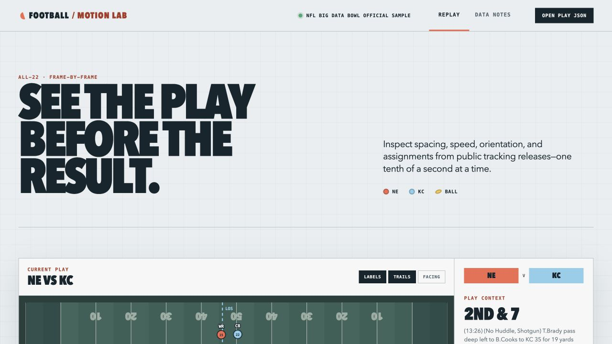

# Football Motion Lab

A local-first NFL tracking analysis workbench: animate one play at 10 Hz, inspect
players frame by frame, and measure spacing without losing sight of where the
data came from.



The first vertical slice is intentionally narrow. It handles NFL Big Data Bowl
tracking exports, normalizes every play so the offense moves left-to-right, and
renders a fast custom-SVG replay with player inspection and spatial summaries.

## What works now

- Animated all-22 + football field replay
- Frame scrubbing, event jumps, and 0.5× / 1× / 2× playback
- Player labels, recent movement trails, and facing-direction overlays
- Per-frame speed, acceleration, location, matchup separation, and formation width
- Big Data Bowl CSV → compact play JSON extraction
- Correct 180° normalization of leftward plays, including `x`, `y`, `dir`, and `o`
- A clearly labeled schematic demo for immediate use

The bundled play is generated, not an NFL play. Kaggle requires users to sign in
and accept the Big Data Bowl competition rules, so this repository does not
redistribute the raw competition files.

## Quick start

Requires Python 3.11+ and Node 20.19+.

```bash
make setup
make demo
make sample  # optional: ingest the official 2017 sample and open a real play
make dev
```

Open the Vite URL (normally <http://localhost:5173>).

## Load public tracking data

1. Join an NFL Big Data Bowl competition on Kaggle and accept its rules.
2. Download and unzip `tracking_week_*.csv`, `plays.csv`, and `players.csv`.
3. Build the local catalog:

```bash
uv run football ingest bdb \
  --input data/raw/nfl-big-data-bowl-2025 \
  --database data/db/football.duckdb

uv run football health
uv run football plays --season 2022 --week 1 --offense BUF --play-type pass
```

The catalog validates the release, records a content fingerprint, and indexes
games, plays, players, and weekly tracking-file locations in DuckDB. It leaves
the large tracking CSVs in place rather than duplicating them. Re-ingesting an
unchanged release is idempotent.

### Tracking quality and provenance

Ingest also streams every tracking file once and assesses each play (field bounds,
frame order, 10 Hz cadence, player identity, football coverage, event order, entity
count, direction normalization, and more). Expect a few minutes for a full release.
The ingest output includes a machine-readable `quality` summary; to re-emit it later,
or to list every play that is not valid with its findings:

```bash
uv run football quality --database data/db/football.duckdb
uv run football quality --status invalid --summary-only
uv run football plays --quality-status incomplete
```

Plays are graded `valid`, `incomplete` (usable but missing or suspect data),
`invalid` (corrupt), or `generated` (the demo). Every served play carries a
`provenance` block (release, files, software version, direction handling, available
and missing source fields, nflverse join status, and the full check results), and the
web app shows it beside the replay. Fields a source never provides, such as
acceleration in the legacy 2017 sample, are disclosed but do not make a play
incomplete.

### Add nflverse play-by-play context

Download `play_by_play_<season>.parquet` for the seasons in your catalog from the
[nflverse-data `pbp` release](https://github.com/nflverse/nflverse-data/releases/tag/pbp)
into their own directory, then join them:

```bash
uv run football ingest nflverse --input data/raw/nflverse-pbp
uv run football plays --join-status unmatched
uv run football plays --epa-min 1.0
```

Big Data Bowl `gameId`/`playId` are joined to nflverse `old_game_id`/`play_id`
within the same season. Nothing is dropped when a join fails: each tracking play
reports `matched`, `conflicting` (joined but quarter or down disagrees),
`unmatched` (season loaded, no row), or `unavailable` (no file for that season).
The ingest report and `GET /data-health` give measured coverage by season and
week, plus fields a season's file does not contain at all (for example formation
and personnel before 2020). nflverse rows live in separate DuckDB tables, so
re-ingesting tracking never discards them. EPA and WPA are nflverse model
outputs, not tracking measurements.

To export a cataloged play for the current file-opening workflow, use:

```bash
uv run football export \
  --database data/db/football.duckdb \
  --game-id 2022090800 \
  --play-id 56 \
  --output data/exports/2022090800-56.json
```

Use **Open play JSON** in the app and select that export. The catalog loader
streams the week CSV and retains only the selected play, so memory use does not
scale with the full tracking file.

The official NFL GitHub sample uses an older game-level schema. Place its four
CSVs in `data/raw/nfl-official-2017-sample/`, then run `make sample`. The
catalog maps its legacy `frame.id`, `team`, player-name, and position fields,
infers play direction from the line of scrimmage when possible, and reports
acceleration and body orientation as unavailable rather than fabricating zeros.

## Local API

Start the read-only catalog API and web app in separate terminals:

```bash
make api
make dev
```

The API exposes `GET /health`, `GET /data-health`, filtered and paginated
`GET /plays` (including `epa_min`, `epa_max`, and `join_status` filters), and
`GET /plays/{game_id}/{play_id}`. The Vite development server proxies them under
`/api` to `127.0.0.1:8000`. Responses include source provenance and nflverse
join status without exposing absolute raw-data paths or serving source CSV files.

The 2025 Big Data Bowl field contract is documented on the
[official Kaggle data page](https://www.kaggle.com/competitions/nfl-big-data-bowl-2025/data).
It provides game, play, player, player-play, and weekly tracking CSVs. Tracking
rows contain `gameId`, `playId`, `nflId`, `frameId`, `x`, `y`, `s`, `a`, `dir`,
`o`, `event`, and `playDirection`; a missing `nflId` identifies the football.

## Data sources and boundaries

| Source | Best use here | Access and terms |
|---|---|---|
| NFL Big Data Bowl | Player and football coordinates, speed, acceleration, orientation, tagged events | Public after Kaggle sign-in and acceptance; subject to competition rules |
| nflverse | Play-by-play context, EPA/WPA, rosters, schedules, participation | GitHub releases in CSV, Parquet, RDS, and other formats; repository metadata is CC BY 4.0 |

Big Data Bowl coverage is a selected release, not a continuous public archive of
every NFL game. Do not describe a model trained on one release as league-wide
without evaluating the release's seasons, weeks, play filters, and competition
task.

The Big Data Bowl keys can be joined to nflverse play-by-play using `gameId` ↔
`old_game_id` and `playId` ↔ `play_id`, as noted in the official competition
documentation.

## Architecture

```text
packages/ftbdata   streaming CSV ingest, coordinate normalization, JSON export
apps/web           React + TypeScript, custom SVG field and analysis UI
data/raw           user-downloaded source files (gitignored)
data/exports       extracted play JSON (gitignored)
data/db            local DuckDB catalogs (gitignored)
```

This mirrors the baseball project's local-first shape while keeping the first
slice dependency-light. The play JSON is a deliberate seam: the visualization
does not need to know whether a later backend uses CSV, Parquet, DuckDB, or an
API.

## Tests

```bash
make test
make web-build
```

The Python tests cover release validation, idempotent catalog ingestion,
filtered play search, catalog health, frame ordering, ball handling, player
metadata, and leftward-play rotation. The web tests cover derived spatial
metrics and event labels; typechecking and the production build catch the
integration surface.

## Next useful slices

1. Profile cataloging against an accepted full release and add resumable fingerprint checkpoints.
2. Add per-play provenance and tracking-quality badges (Milestone 2).
3. Derive route geometry, defender leverage, pocket shape, and separation-over-time curves.
4. Ingest nflverse participation data for formation and personnel in seasons that lack them.
6. Train only after establishing season/game splits that prevent play-family and team leakage.
